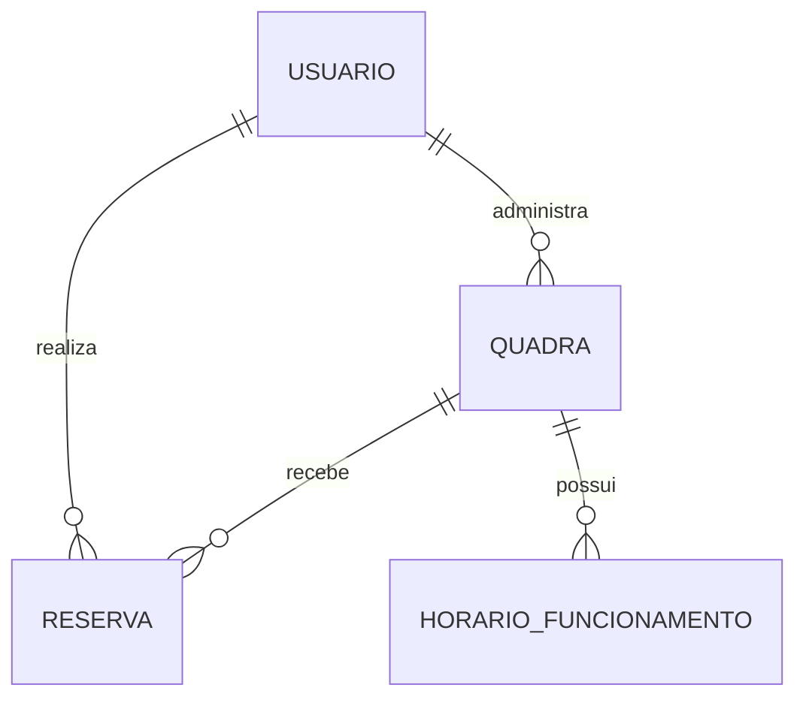

# Modelo inicial do MVP

Este é um modelo conceitual inicial. As classes Java são records, sem JPA, tabelas ou persistência configurada nesta etapa.

## Entidades

| Entidade | Atributos principais |
|---|---|
| Usuário | id, nome, e-mail, perfil (CLIENTE ou PROPRIETARIO) |
| Quadra | id, proprietárioId, nome, modalidade, preçoHora, ativa |
| HorárioFuncionamento | quadraId, diaSemana, abertura, fechamento |
| Reserva | id, clienteId, quadraId, início, fim, valorTotal, estado (CONFIRMADA ou CANCELADA) |

## Relacionamentos

- Um proprietário pode administrar várias quadras; cada quadra tem um proprietário.
- Uma quadra pode ter até sete registros de funcionamento, um por dia da semana.
- Um cliente pode realizar várias reservas; cada reserva pertence a um cliente.
- Uma quadra pode receber várias reservas, respeitando a regra de não sobreposição.



Representação textual para leitores sem suporte a Mermaid:

```text
Usuário (proprietário) 1 ── N Quadra
Usuário (cliente)     1 ── N Reserva
Quadra               1 ── N Reserva
Quadra               1 ── N HorárioFuncionamento
```

## Regras previstas para a persistência

1. Fim da reserva deve ser posterior ao início e respeitar funcionamento.
2. Preços positivos, representados por decimal, sem ponto flutuante para dinheiro.
3. Valor total preservado na reserva, mesmo se o preço da quadra mudar depois.
4. Reservas confirmadas da mesma quadra não podem se sobrepor. Intervalos seguem `[início, fim)`: 18h–19h e 19h–20h são compatíveis.
5. A futura migration PostgreSQL deve aplicar uma restrição de exclusão para os intervalos ativos; só consultar antes de inserir é insuficiente sob concorrência.
6. Reservas canceladas permanecem no histórico, mas deixam de ocupar o horário.
7. Operações críticas serão transacionais. Cada pessoa acessará somente seus dados ou suas quadras.
8. Instantes serão armazenados em `timestamptz` e exibidos no fuso de Brasília. Funcionamento usa dia da semana e hora local.

Pagamentos, credenciais de acesso e dispositivos não fazem parte deste recorte e, por isso, não aparecem neste modelo.
