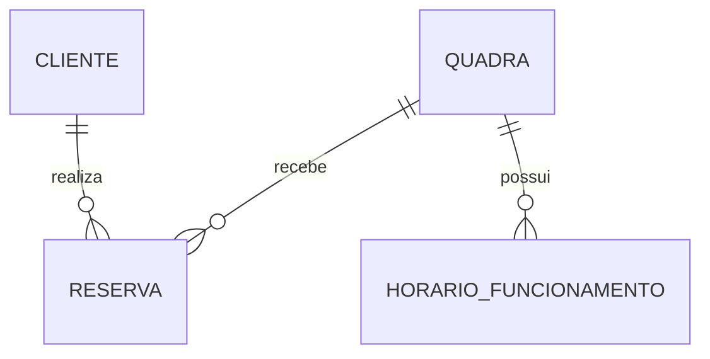

# Modelo inicial do MVP

Este é um modelo conceitual do recorte da disciplina. As classes Java atuais são records, sem JPA, tabelas ou persistência configurada. O record `Usuario` ainda existe no código e será substituído por `Cliente` nas issues de implementação (B03 e B06), já que login e perfis ficaram fora desta etapa.

## Entidades

| Entidade | Atributos principais |
|---|---|
| Cliente | id, nome, e-mail (se mantido no contrato HTTP) |
| Quadra | id, nome, modalidade, preçoHora, ativa |
| HorárioFuncionamento | quadraId, diaSemana, abertura, fechamento |
| Reserva | id, clienteId, quadraId, início, fim, valorTotal, estado (CONFIRMADA ou CANCELADA) |

## Relacionamentos

- Um cliente pode realizar várias reservas; cada reserva pertence a um cliente.
- Uma quadra pode receber várias reservas, respeitando a regra de não sobreposição; cada reserva pertence a uma quadra.
- Uma quadra pode ter até sete registros de funcionamento, um por dia da semana.
- Não há relacionamento `ManyToMany`.



Representação textual para leitores sem suporte a Mermaid:

```text
Cliente  1 ── N Reserva
Quadra   1 ── N Reserva
Quadra   1 ── N HorárioFuncionamento
```

## Regras previstas para a persistência

1. Início da reserva anterior ao fim; o intervalo deve respeitar o funcionamento da quadra.
2. Cliente e quadra precisam existir, e quadra desativada não aceita novas reservas.
3. Duração mínima de 1 hora, em incrementos de 30 minutos (proposta atual, a confirmar no contrato HTTP).
4. Preços positivos, representados por `BigDecimal`, sem ponto flutuante para dinheiro.
5. Valor total calculado pelo backend e preservado na reserva, mesmo se o preço da quadra mudar depois.
6. Reservas confirmadas da mesma quadra não podem se sobrepor. Intervalos seguem `[início, fim)`: 18h–19h e 19h–20h são compatíveis, e quadras diferentes podem ter o mesmo intervalo.
7. Só consultar antes de inserir é insuficiente sob concorrência. A verificação e a gravação ocorrem em uma transação, com bloqueio pessimista do registro da quadra, compatível com o H2. Esse comportamento será validado por um teste com duas solicitações simultâneas.
8. Reservas canceladas permanecem no histórico, mas deixam de ocupar o horário. O cancelamento é permitido enquanto a reserva ainda não começou (proposta atual, a confirmar na issue B11).
9. Alterar o funcionamento de uma quadra não pode invalidar reservas confirmadas existentes.
10. Os horários usam o fuso de Brasília (`America/Sao_Paulo`). Funcionamento usa dia da semana e hora local.

## Banco de dados

Esta etapa usa o **H2**, em memória, apenas com finalidade didática. Em uma versão futura, PostgreSQL/Supabase poderá substituí-lo, com restrição de exclusão para intervalos de reservas confirmadas no próprio banco.

Pagamentos, credenciais de acesso e dispositivos não fazem parte deste recorte e, por isso, não aparecem neste modelo.
